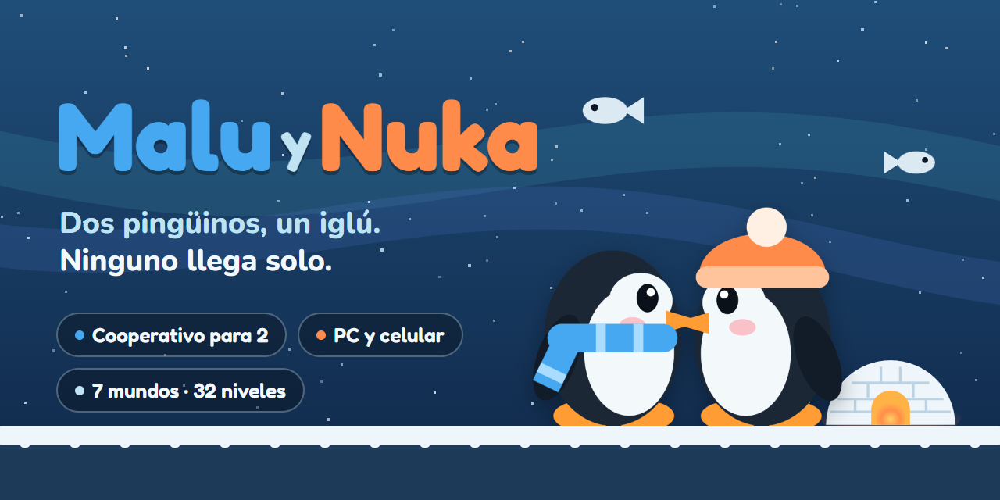
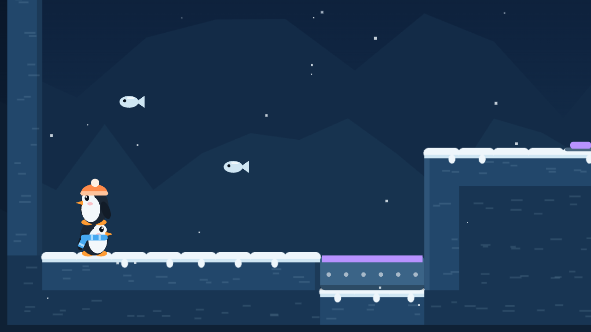
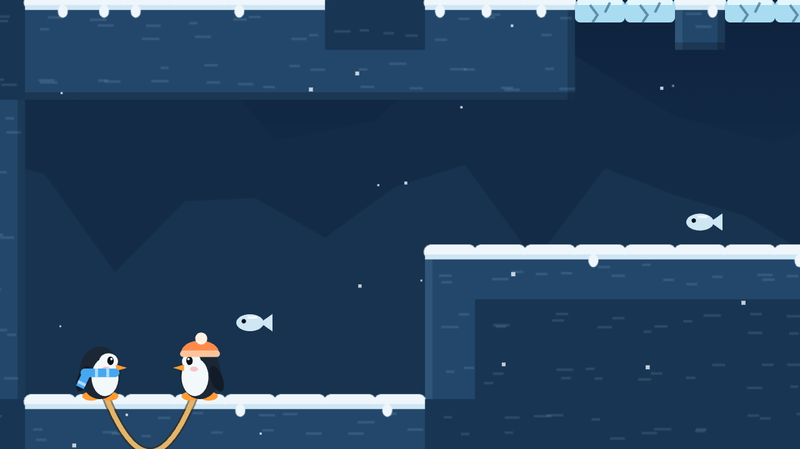
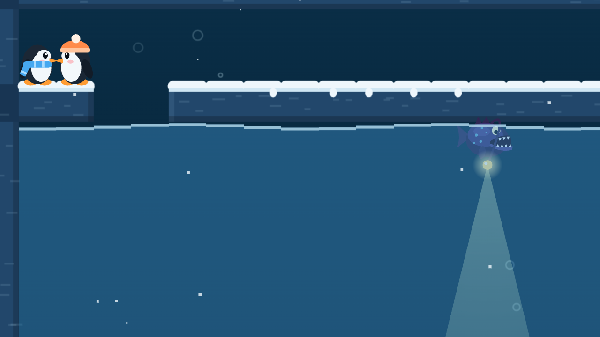
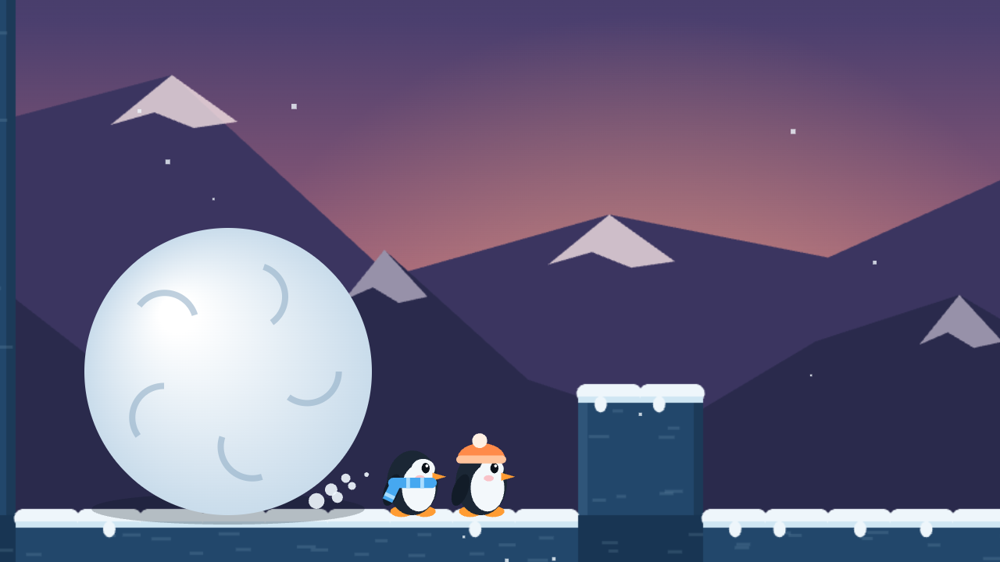
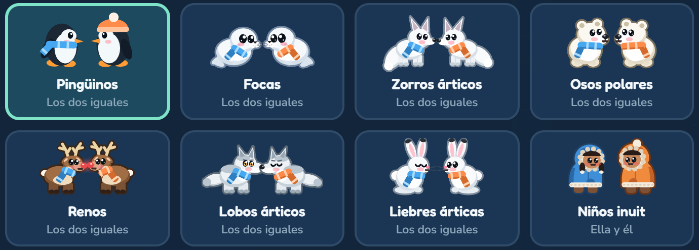
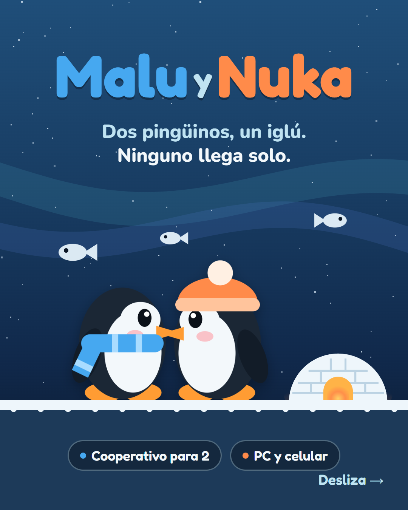
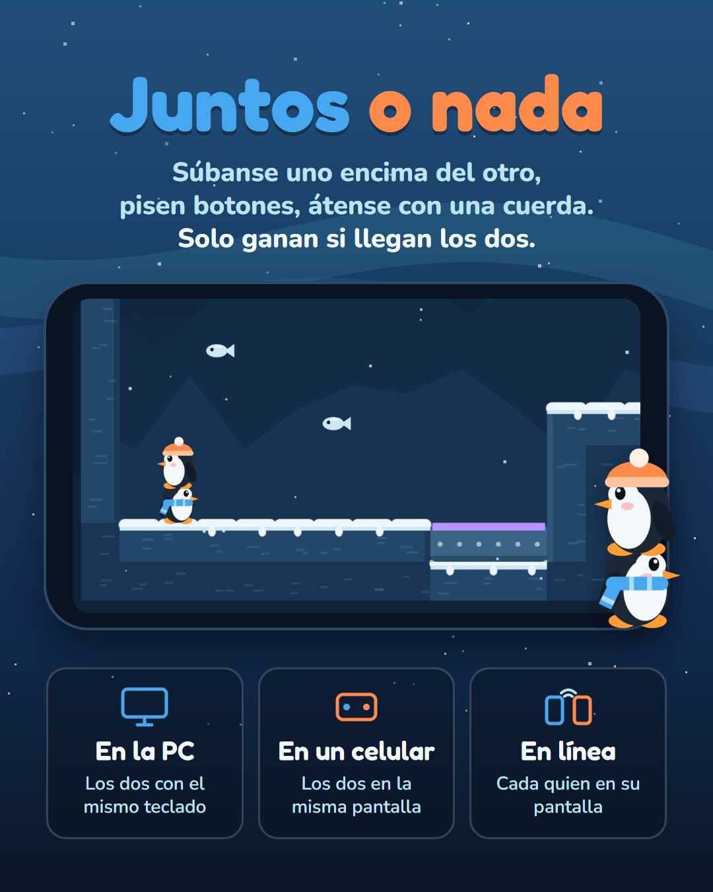
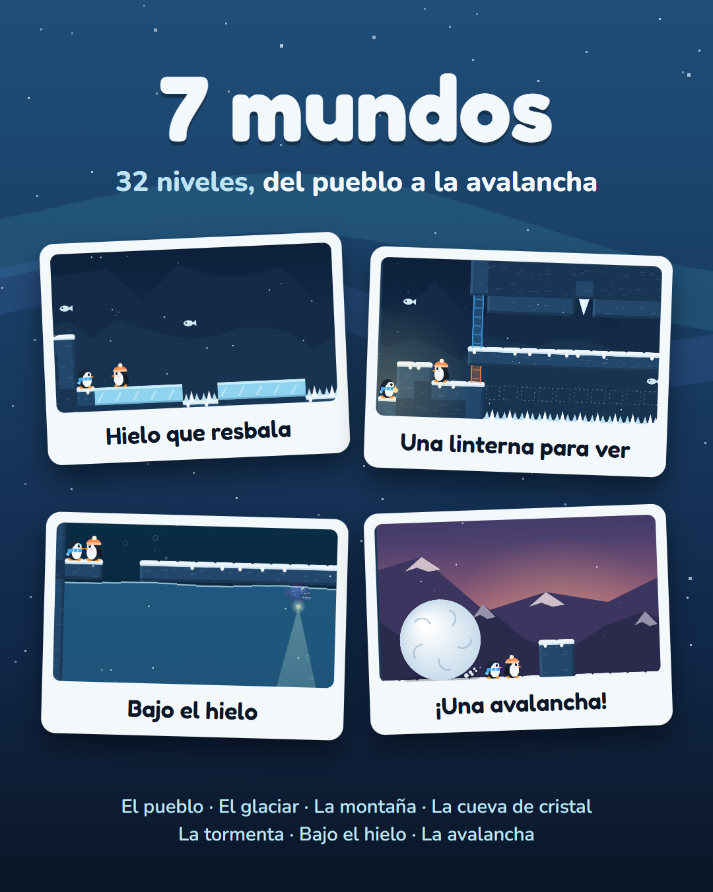
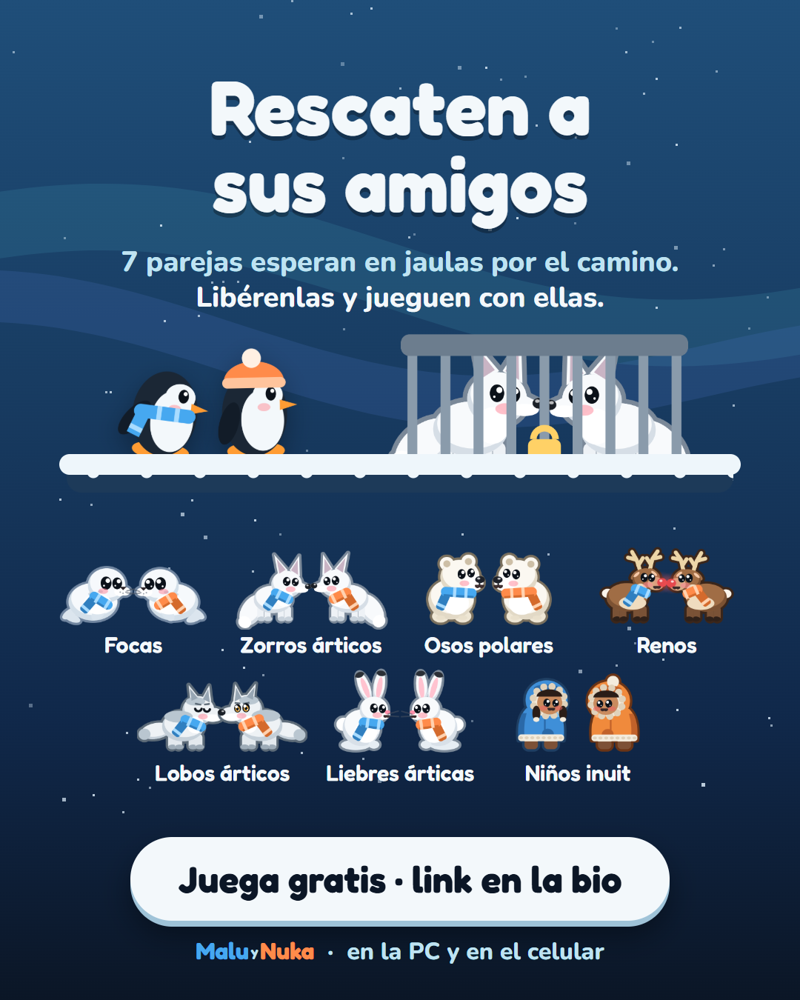

<p align="center">
  
</p>

# Malu y Nuka

Un juego cooperativo de plataformas para dos pingüinos: Malu, azul, y Nuka, naranja. Resuelvan los niveles en equipo, recojan peces y lleguen juntos al iglú.

Se juega en la PC o en el celular: los dos con el mismo teclado, los dos en la misma pantalla táctil o en línea, cada quien en su dispositivo. La versión web es el juego principal y puede publicarse como sitio estático en GitHub Pages.

## Cómo es el juego

- **Juntos o nada:** ninguno llega solo. Súbanse uno sobre la cabeza del otro, pisen botones para abrir puertas y átense con una cuerda.
- **7 mundos y 32 niveles:** del pueblo a la avalancha, con hielo resbaloso, viento, linternas, buceo bajo el hielo y una bola de nieve gigante.
- **Amigos para rescatar:** 7 parejas de animales del Ártico esperan en jaulas por el camino. Al liberarlas, pueden jugar con ellas.

<table>
  <tr>
    <td width="50%"><br><sub>Mundo 1: uno sobre la cabeza del otro para subir el muro.</sub></td>
    <td width="50%"><br><sub>Mundo 3: atados con una cuerda.</sub></td>
  </tr>
  <tr>
    <td width="50%"><br><sub>Mundo 6: bajo el hielo, lejos de la luz del rape.</sub></td>
    <td width="50%"><br><sub>Mundo 7: una bola de nieve gigante que nunca se detiene.</sub></td>
  </tr>
</table>

### Personajes

<p></p>

Malu va a la izquierda con la bufanda azul y Nuka a la derecha con la naranja. Los pingüinos están libres desde el principio; las demás parejas se desbloquean al rescatarlas. Todas se juegan igual.

## Jugar en la web

### Abrir la versión local

Necesitas Node.js 22 o posterior. Desde la carpeta del proyecto, ejecuta:

```bash
npm ci
npm run build
npm run web
```

Abre [http://localhost:5320](http://localhost:5320) para jugar. La raíz redirige a [http://localhost:5320/publico/](http://localhost:5320/publico/), la misma carpeta estática que se publica en GitHub Pages.

### Controles

- **Malu:** `A` y `D` para moverse, `W` para saltar y `S` para agarrar.
- **Nuka:** flechas izquierda y derecha para moverse, `↑` para saltar y `↓` para agarrar.
- **Pantallas táctiles:** usa los controles en pantalla. El juego admite orientación horizontal.
- **En línea:** elige **En línea** en el menú, crea una sala y comparte el código con tu pareja para que se una desde su dispositivo.

## Publicar en GitHub Pages

El repositorio ya incluye una acción de GitHub que construye la web y publica `publicar/` automáticamente al hacer push a `main` o `master`.

1. Sube el proyecto completo a un repositorio de GitHub.
2. En el repositorio, abre **Settings → Pages**.
3. En **Build and deployment → Source**, selecciona **GitHub Actions**.
4. Sube los cambios a `main` o `master`, o ejecuta manualmente el flujo **Publicar juego web** desde **Actions**.
5. Al terminar el flujo, GitHub mostrará la dirección del sitio en **Settings → Pages**. Para un repositorio de proyecto suele tener el formato `https://USUARIO.github.io/REPOSITORIO/`.

`npm run build` genera en `publicar/` un `index.html` junto con las fuentes locales y PeerJS. Las rutas de esos recursos son relativas para que funcionen bajo la subruta que GitHub Pages asigna a cada repositorio. No edites los archivos generados dentro de `publicar/`; haz los cambios en `src/` y vuelve a ejecutar el build.

El modo en línea requiere conexión a internet y un sitio servido por HTTPS, como GitHub Pages. Usa PeerJS y WebRTC para conectar las salas entre dispositivos.

## Material de promoción

<p>
  
  
  
  
</p>

La carpeta `promo/` reúne el material para redes sociales:

- `promo/carrusel/`: las 4 slides del carrusel de Instagram, en 1080×1350.
- `promo/banner.png`: el banner de este README, en 1280×640. También sirve como vista previa social del repositorio.
- `promo/readme/`: los recortes de niveles que se muestran en este README.
- `promo/prompt-instagram.md`: el prompt para generar el carrusel con ChatGPT o Gemini y el texto de la publicación.
- `promo/referencias/`: capturas del juego y de los personajes para adjuntar al prompt.
- `promo/fuente/`: el HTML con el que se armaron el carrusel y el banner. Los personajes están dibujados con el mismo código del juego.

## Desarrollo

Los archivos fuente del juego están en `src/`. Para añadir o ajustar niveles, consulta `src/levels/` y `src/pistas.js`. Los archivos HTML, JavaScript y recursos estáticos listos para alojar se generan con `build.js`.

La monetización se controla con `MONETIZATION_ENABLED` en `src/08-monetizacion.js`; está en `false` por defecto, así que no aparecen anuncios ni la opción de pago.

```text
src/                    Interfaz web, motor, controles y niveles
publicar/               Sitio estático generado para GitHub Pages
assets/                 Recursos gráficos de origen
promo/                  Material de promoción: carrusel, banner y capturas
.github/workflows/      Automatización de GitHub Pages
mobile/                 Proyecto React Native independiente, actualmente en pausa
```

## Licencia y créditos

Este repositorio contiene el juego Malu y Nuka y sus recursos. Los avisos de licencia de PeerJS y las fuentes están incluidos en `publicar/lib/` y `publicar/fonts/` al generar el sitio.
